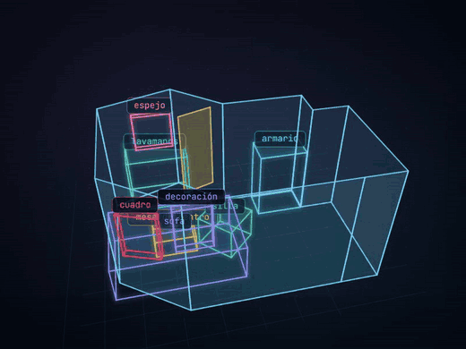
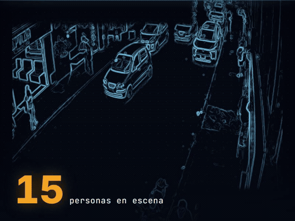
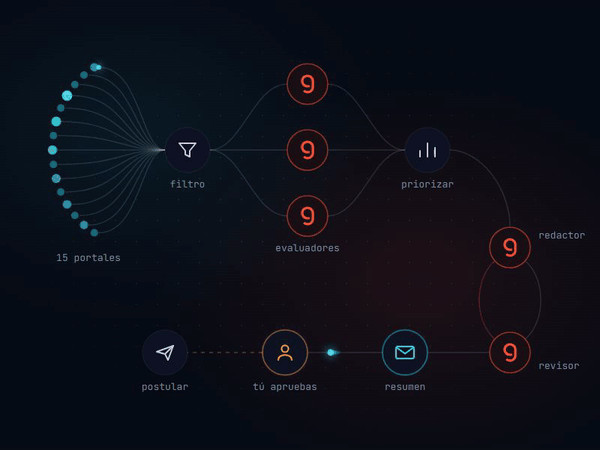
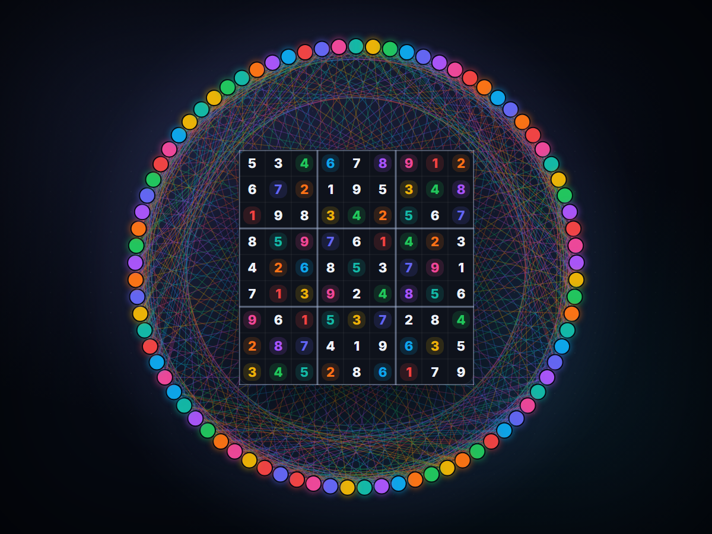

<!-- Animated Typing -->

  

  

  

---

<table>
<tr>
<td width="65%" valign="top">
🌍 About Me / Sobre Mí 

<b>🇪🇸 Español</b>

### 👨‍🎓 Perfil 

Soy estudiante de **Matemáticas Aplicadas y Ciencias de la Computación** en la universidad del Rosario y aquí comparto algunos de los proyectos más relevantes en distintas áreas de interés.

### 🎯 Áreas de Especialización

- **🧠 Machine Learning & Deep Learning**: aprendizaje supervisado/no-supervisado, redes neuronales.
- **📊 Estadística**: Análisis exploratorio de datos (EDA), inferencia, regresión, pruebas de hipótesis, PCA.
- **🧮 Computación Científica**: Métodos numéricos, interpolación, geometría computacional.
- **⚙️ Ingeniería de Software y Automatización**: APIs, FastAPI, Testing.
- **📈 Business Intelligence & Visualization**: Plotly, Gradio, PowerBI

## 🚀 Proyectos Destacados

<table>
<tr>
<td align="center" width="50%">
<h5>Reconstrucción 3D y Detección de Objetos en Interiores</h5>

 

</td>

<td align="center" width="50%">
<h5>Detección de Aglomeraciones (Yolov11)</h5>

 

</td>
</tr>

<tr>
<td align="center" width="50%">
<h5>Sistema Multiagente de Empleo (LangGraph)</h5>

 

</td>

<td align="center" width="50%">
<h5>Resolviendo sudokus mediante teoría de grafos</h5>

 

</td>
</tr>
</table>

<b>🇬🇧 English</b>

### 👨‍🎓 Overview

I am a student of **Applied Mathematics and Computer Science** at the University of Rosario and here I share some of the most most relevant projects in different areas of interest.

### 🎯 Areas of Specialization

- **🧠 Machine Learning & Deep Learning**: supervised/unsupervised learning, neural models.
- **📊 Statistics**: Exploratory Data Analysis (EDA), Inference, Regression, Hypothesis Testing, PCA.
- **🧮 Scientific Computing**: Numerical Methods, Interpolation, Computational Geometry.
- **⚙️ Software Engineering & Automation**: APIs, FastAPI, Testing
- **📈 Business Intelligence & Visualization**: Plotly, Gradio, Power BI (Basic)

  
## 🚀 Featured Projects

<table>
<tr>
<td align="center" width="50%">
<h5>3D Reconstruction and Indoor Object Detection </h5>

 

</td>

<td align="center" width="50%">
<h5>Crowd Detection (Yolov11)</h5>

 

</td>
</tr>

<tr>
<td align="center" width="50%">
<h5>Multi-Agent Job Search System (LangGraph)</h5>

 

</td>

<td align="center" width="50%">
<h5>Solving Sudoku Puzzles Using Graph Theory</h5>

 

</td>
</tr>
</table>

</td>

<!-- Right Column -->
<td width="35%" valign="top">

## 🧰 Developer Toolbox

### Programming Languages

  

### AI & Machine Learning

  

### Web & API Development

  

### Development Tools

  

### 3D / Graphics / Engineering Software

  

---

⚡ Fast Facts

| 🏓 Hobbies | 🌍 Languages | 💻 OS |
|:---:|:---:|:---:|
| Table tennis | ES (Native) | Linux Mint |
| Competitive Programming | EN (B2) | Windows |

---

</td>
</tr>
</table>

 
 

<picture>
  <source media="(prefers-color-scheme: dark)" srcset="https://raw.githubusercontent.com/abozanona/abozanona/output/pacman-contribution-graph-dark.svg">
  <source media="(prefers-color-scheme: light)" srcset="https://raw.githubusercontent.com/abozanona/abozanona/output/pacman-contribution-graph.svg">
  
</picture>

